<p align="right"><b>English</b> · <a href="https://github.com/pandazki/pandazki/blob/main/README.zh-CN.md">简体中文</a></p>

<picture>
  <source media="(prefers-color-scheme: dark)" srcset="assets/hero-dark.svg">
  
</picture>

### Pneuma

<picture>
  <source media="(prefers-color-scheme: dark)" srcset="assets/pneuma-concept-dark.svg">
  
</picture>

The Pneuma family is an experiment in re-architecting software for the agent-native era. Once agents do most of the execution, distribution, domain modelling, change governance and knowledge all have to be redesigned; each repository rebuilds one of those layers.

#### [pneuma-skills](https://github.com/pandazki/pneuma-skills)



An experiment in software distribution — software used to ship features; this ships domain capability, built on mainstream coding harnesses, with long-horizon user preferences maintained automatically. You don't get an app: you fork a capability from a scenario you care about.

The collaboration isn't a black box either. Agents work in files on disk; Pneuma renders the workspace as live, domain-native views — decks, documents, boards, timelines — and people enter the loop through direct edits or structured suggestions, without breaking the agent's flow. Backends: Claude Code, Codex and Kimi Code.

```bash
bunx pneuma-skills slide --workspace ./my-first-pneuma-slide
```

#### [pneuma-knowledge-compiler](https://github.com/pandazki/pneuma-knowledge-compiler)

<picture>
  <source media="(prefers-color-scheme: dark)" srcset="assets/pkc-dark.svg">
  
</picture>

A compiler for a personal knowledge library — meetings, documents, chats, email and your coding-agent sessions are treated as source and compiled, under a compile contract, into a Git-versioned library. Every claim is anchored to its source span, and four access levels run in parallel (L0 verbatim, L1 lexical, L2 semantic, L3 canonical claims): search it, question it, or call it by voice.

#### pneuma-craft · pneuma-framework

<picture>
  <source media="(prefers-color-scheme: dark)" srcset="assets/stack-dark.svg">
  
</picture>

- **[pneuma-craft](https://github.com/pandazki/pneuma-craft)** · The domain kernel for human–AI creation — generative work yields a tree of variants, not an edit history. Provenance is a first-class primitive, and humans and agents act through the same event-sourced command interface.
- **[pneuma-framework](https://github.com/pandazki/pneuma-framework)** · A governance layer for AI-native creation tools — "the agent said so" is not done. The framework owns the sequencing and gates of the change loop (verify, approve, publish, rollback), fail-closed; every effect stays with the host.

### Memory and attention

<picture>
  <source media="(prefers-color-scheme: dark)" srcset="assets/memory-dark.svg">
  
</picture>

**[Nemori](https://github.com/nemori-ai/nemori)** ([paper](https://arxiv.org/abs/2508.03341)) · Self-organising long-term memory for agents. What should the unit of memory be? Nemori's answer is the human episode: it segments dialogue along event boundaries, then uses predict–calibrate to distil new knowledge from the gap between expectation and reality.

- **[fold-skill](https://github.com/nemori-ai/fold-skill)** · Attention, maintained by an agent — when someone comes back after time away, what should they see first? Inputs from many channels become one uniform form; an agent estimates and trades them off in context, keeping a structured state under an attention budget. One state, twelve forms of expression.
### Agent infrastructure

- **[plexus](https://github.com/nemori-ai/plexus)** · An agent-native, self-describing gateway for local capabilities — exposes the software on your machine as semantic facets, and makes authorization and audit domain primitives.
- **[omne-harness-lite](https://github.com/nemori-ai/omne-harness-lite)** · An agent harness for long-running work — sessions, agents, models and tools each own their lifecycle; when an execution process is killed, work resumes under its original responsibility and the original model call picks up where it stopped.
- **[cc-master](https://github.com/nemori-ai/cc-master)** · An orchestration layer for long-horizon work — promotes a coding-agent session to project lead: the task graph survives context resets, thousands of schedule simulations estimate the ship date, and decisions come back to you only when they need your judgment.
- **[Advanced Agentic Dev Patterns](https://panqiwei.github.io/advanced-agentic-dev-patterns/en/)** · A book on agentic systems engineering · co-author: [@panqiwei](https://github.com/PanQiWei)
- **[code-journal](https://github.com/pandazki/code-journal)** · A local almanac of human–agent programming — rebuilds what actually happened from session transcripts, and finds the moments where the human, not the agent, set the direction.

### Activity

<picture>
  <source media="(prefers-color-scheme: dark)" srcset="assets/momentum-dark.svg">
  
</picture>

<sub>Charts drawn by <a href="scripts/render.mjs"><code>scripts/render.mjs</code></a> from GitHub data, refreshed weekly by <a href=".github/workflows/refresh.yml">a workflow</a>.</sub>
