<p align="right"><a href="https://github.com/pandazki">English</a> · <b>简体中文</b></p>

<picture>
  <source media="(prefers-color-scheme: dark)" srcset="assets/hero-dark.svg">
  
</picture>

### Pneuma

<picture>
  <source media="(prefers-color-scheme: dark)" srcset="assets/pneuma-concept-dark.svg">
  
</picture>

Pneuma 家族是对 agent-native 时代软件形态的一次重构实验。当 agent 成为软件的主要执行者，分发、领域建模、变更治理与知识沉淀都需要重新设计；每个仓库各自重写其中一层。

#### [pneuma-skills](https://github.com/pandazki/pneuma-skills)



软件分发层的一次实验——软件过去分发的是功能，这里分发的是领域能力：构建于主流 coding harness 之上，并自动沉淀长程的用户偏好。你获得的不是某个软件，而是从你关心的场景 fork 出来的 capability。

协作也不再是黑盒：agent 在磁盘上的文件里工作，Pneuma 把工作区渲染成领域原生的现场视图——幻灯片、文档、看板、时间线——人以直接编辑或结构化建议进入回路，不打断 agent 的执行流。后端可选 Claude Code、Codex 与 Kimi Code。

```bash
bunx pneuma-skills slide --workspace ./my-first-pneuma-slide
```

#### [pneuma-knowledge-compiler](https://github.com/pandazki/pneuma-knowledge-compiler)

<picture>
  <source media="(prefers-color-scheme: dark)" srcset="assets/pkc-dark.svg">
  
</picture>

个人知识库的编译器——会议、文档、聊天、邮件与你的 coding-agent 会话都被当作源码，按编译契约编译成 Git 版本化的知识库。每条主张锚定到原文片段；L0 原文、L1 词法、L2 语义、L3 正本主张四层并行可达——可检索、可追问，也可语音直连。

#### pneuma-craft · pneuma-framework

<picture>
  <source media="(prefers-color-scheme: dark)" srcset="assets/stack-dark.svg">
  
</picture>

- **[pneuma-craft](https://github.com/pandazki/pneuma-craft)** · 人机协同创作的领域内核——生成式创作产出的不是编辑历史，而是一棵变体树。溯源是一等原语，人与 agent 共用同一套事件溯源的命令接口。
- **[pneuma-framework](https://github.com/pandazki/pneuma-framework)** · AI-Native 创作工具的治理层——agent 说"完成"不算数。框架只掌控变更循环的时序与关卡（验证、审批、发布、回滚），默认 fail-closed；一切副作用归宿主所有。

### Agent Harness

<picture>
  <source media="(prefers-color-scheme: dark)" srcset="assets/omne-dark.svg">
  
</picture>

**[omne-harness-lite](https://github.com/nemori-ai/omne-harness-lite)** · 以 Cordis 为内核、为长期运行而设计的 agent harness——进程会死，工作不该随之消失。Agent 运行时与持久状态解耦：执行进程中途被杀，新进程依据 Journal 认回原责任；未决的模型调用沿原引用续接而非重发，等待中的工作在唤醒后与原操作对账，结果未知就如实保持未知。能力在运行期动态演化，租户隔离从第一天落实，全链路可观测。目前处于 0.0.0 → 0.1.0 研发阶段。

### 记忆与注意力

<picture>
  <source media="(prefers-color-scheme: dark)" srcset="assets/memory-dark.svg">
  
</picture>

**[Nemori](https://github.com/nemori-ai/nemori)**（[论文](https://arxiv.org/abs/2508.03341)）· Agent 的自组织长期记忆。记忆该以什么粒度组织？Nemori 的答案是人类的情景记忆：依事件分割理论把对话切成情景，再以预测—校准机制，从预期与现实的偏差中提炼新知识。

<picture>
  <source media="(prefers-color-scheme: dark)" srcset="assets/fold-dark.svg">
  
</picture>

**[fold-skill](https://github.com/nemori-ai/fold-skill)** · Agent 驱动的注意力整理——人离开再回来，最先该看到什么？多渠道信息被统一为同构输入，由 agent 结合上下文估计与取舍，维护成一份带注意力预算的结构化状态；同一份状态，十二种表达形式。

### Agent 基础设施

<picture>
  <source media="(prefers-color-scheme: dark)" srcset="assets/plexus-dark.svg">
  
</picture>

**[plexus](https://github.com/nemori-ai/plexus)** · Agent-Native 本地能力自描述网关——以语义切面暴露本机软件，将授权与审计内化为领域原语。

- **[cc-master](https://github.com/nemori-ai/cc-master)** · 长程任务的编排层——把一个 coding agent 会话升格为项目负责人：任务图跨越上下文重置持续存在，数千次排期模拟估算交付时间，只在真正需要判断时把决策交还给人。
- **[Advanced Agentic Dev Patterns](https://panqiwei.github.io/advanced-agentic-dev-patterns/zh/)** · 一本关于 agentic 系统工程的书 · co-author: [@panqiwei](https://github.com/PanQiWei)
- **[code-journal](https://github.com/pandazki/code-journal)** · 人机协作编程的本地年鉴——从会话转录中重建每天真正发生了什么，并定位那些由人而非 agent 决定方向的时刻。

### 动态

<picture>
  <source media="(prefers-color-scheme: dark)" srcset="assets/momentum-dark.svg">
  
</picture>

<sub>图表由 <a href="scripts/render.mjs"><code>scripts/render.mjs</code></a> 根据 GitHub 数据生成，<a href=".github/workflows/refresh.yml">每周自动刷新</a>。</sub>
